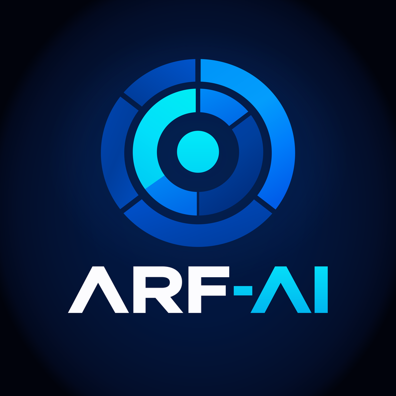
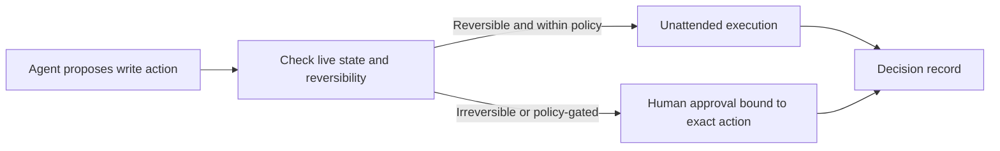

<p align="center">
  
</p>

<h1 align="center">ARF AI</h1>

<p align="center">
  <strong>Bounded write access for infrastructure agents.</strong><br>
  Which production changes an agent may make on its own, which must wait for a person, and what record remains.
</p>

<p align="center">
  <a href="https://www.arf-ai.com"><b>Website</b></a> ·
  <a href="https://www.arf-ai.com/pricing"><b>Pricing</b></a> ·
  <a href="https://www.arf-ai.com/dashboard"><b>Console</b></a> (simulated data) ·
  <a href="https://arf-foundation.github.io/pitch-deck/"><b>Pitch deck</b></a> ·
  <a href="mailto:juan@arf-ai.com"><b>juan@arf-ai.com</b></a>
</p>

---

### What ARF AI does

AI agents are starting to make infrastructure changes instead of just recommending them. ARF AI starts with one named write path, storage first, and maps four things:

- what the agent can change;
- whether each change can be undone;
- when a person must approve;
- what record remains for your customer's security review.

For modeled storage actions, ARF does four things before the action runs:

- checks live system state;
- requires approval for a change that can't be undone;
- binds each approval to the exact action;
- records the decision.



This is demonstrated today on a simulated cluster.

### How to work with us

| Step | What you get | Deliverable | Price |
|---|---|---|---|
| **Pilot snapshot** | One agent, five named write tools: which actions could run unattended and which need approval | Short written summary | Free · limited founding availability (scope confirmed on a call; public reference optional) |
| **Write-access review** | Up to 10 named write operations in one environment/provider and up to 200 supplied records: reversibility from evidence, unattended vs. approval-required, and explicit gaps | Inventory and recoverability map, decision memo, scored history where modeled, gap list, readout | **$4,500** fixed · one agent (50% deposit after agreed scope) |
| **Continuous gate** | ARF in your agent's write path, where that path is modeled (demonstrated today for ONTAP storage operations on a simulated cluster) | Scoped per engagement | By invitation, after a review |

The snapshot and the review both work from read-only material: tool definitions, traces and action history.

**[Request a pilot →](https://www.arf-ai.com/signup)** · **[Book 30 minutes](https://calendly.com/petter2025us/30min)**

### Try the sandbox

The public sandbox returns **simulated** decisions against a simplified mock event schema (not a live storage cluster and not the engine). You can also explore the interactive **[Console (simulated data)](https://www.arf-ai.com/dashboard)** in your browser.

```bash
curl -X POST https://arf-ai-arf-sandbox-api.hf.space/v1/evaluate \
  -H "Content-Type: application/json" \
  -d '{"service_name":"api","event_type":"latency","severity":"high","metrics":{"latency_ms":450}}'
```

Observed simulated response (the Hugging Face Space may take a few seconds on cold start):

```json
{
  "status": "success",
  "recommendation": "ESCALATE",
  "risk_score": 0.6227,
  "confidence": 0.8382,
  "justification": "Simulated evaluation for api: latency severity=high. Risk score 0.62 → ESCALATE. (Mock response, not real inference.)",
  "policy_violations": []
}
```

### Public repositories

| Repository | What it is | License |
|---|---|---|
| [arf-frontend](https://github.com/arf-foundation/arf-frontend) | Source of arf-ai.com: the site, the sandbox UI and the simulated console | Apache 2.0 |
| [pitch-deck](https://github.com/arf-foundation/pitch-deck) | Investor overview | Deck content: free to view and link to; copying or adapting it needs written permission. The page's own code: Apache 2.0. |
| [arf-pattern-examples](https://github.com/petter2025us/arf-pattern-examples) | Independent reference code for the propose → decide → record pattern. It contains none of ARF's engine. | Apache 2.0 |

> [!IMPORTANT]
> **The engine is private.** ARF's engine, enterprise layer, API and specifications are proprietary and access-controlled. Nothing on this page describes how they work internally.

> [!WARNING]
> **Unmaintained early prototypes on a former personal account.** Public repositories named `agentic-reliability-framework` and `arf-api-repository` sit on a personal account that is no longer maintained. They hold an early prototype published in 2025 and early 2026, which is **not** ARF's current engine:
> - it has received none of the fixes made since March 2026;
> - it lacks the admission, approval-ledger and audit-verification layers ARF has added since.
>
> Please don't run it. Its old releases on PyPI have been removed. For maintained public reference code, see [arf-pattern-examples](https://github.com/petter2025us/arf-pattern-examples).

### Intellectual property

This page carries high-level information only. The private engine's algorithms, source code and implementation methods remain trade secrets of Juan Petter (ARF Foundation). This profile grants no rights beyond those in the applicable LICENSE files:

- **This repository's [LICENSE](https://github.com/arf-foundation/.github/blob/main/LICENSE)** permits viewing these profile materials for informational and evaluation purposes only, and restricts copying, redistribution, reverse engineering, and AI training.
- **Each public repository above** states its own license.

### Contact

[juan@arf-ai.com](mailto:juan@arf-ai.com) · [arf-ai.com](https://www.arf-ai.com) · [Book 30 minutes](https://calendly.com/petter2025us/30min)
